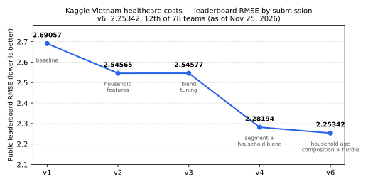

# Healthcare Cost Prediction

Machine-learning pipelines for predicting individual healthcare costs with
gradient boosting — built and validated end to end on Kaggle.

## What's here

| File | What it does |
|---|---|
| `public_medical_cost_baseline.py` | Complete, verified baseline on the public *Medical Cost Personal* dataset (1,338 rows): EDA, feature engineering, 5-fold cross-validation, metrics reported on the original cost scale. |
| `vietnam_competition_baseline.py` | The same pipeline adapted to the Kaggle competition *Predictive Modeling for Healthcare Costs in Vietnam* (evaluation metric: RMSE) — predicts total annual healthcare cost, with explicit leakage guards and a submission writer in the sample format. |
| [`kaggle-vietnam/`](kaggle-vietnam/) | **Full writeup of the completed competition run**: five submissions, best public leaderboard RMSE **2.25342 (12th of 78 teams)**, the household/segment feature engineering behind it, experiment log and final training code. |

## Approach

- **Model:** `HistGradientBoostingRegressor` (scikit-learn)
- **Target transform:** `log1p` — medical costs are heavily right-skewed;
  all metrics are converted back and reported on the original scale
- **Features:** one-hot encoding of categorical variables
  (`sex`, `smoker`, `region` in the public dataset)
- **Validation:** 5-fold cross-validation, shuffled, `random_state=42`
- **Leakage discipline (competition version):** auxiliary observed-cost
  columns (inpatient/outpatient cost and frequency) are explicitly excluded
  from the feature set — they are components of the target, not information
  available at prediction time

## Verified results — public dataset

5-fold cross-validation, original charges scale:

| Metric | Value |
|---|---|
| RMSE | 4,712.21 |
| MAE | 2,341.17 |
| R² | 0.8485 |

Fold RMSEs: 4,474.44 / 4,738.70 / 4,241.65 / 4,996.99 / 5,060.64

## Kaggle Competition — Healthcare Cost Prediction (Vietnam)

Five submissions to the Kaggle community competition *Predictive Modeling
for Healthcare Costs in Vietnam*, improving the public leaderboard RMSE
from 2.69057 to **2.25342 — 12th of 78 teams** (as of Nov 25, 2026). The
gains came from structure, not tuning: the target is exactly
`log1p(outpatient + inpatient cost)` and 81.7% zeros, households are split
across train/test (exploited with strictly out-of-fold household features),
and ID prefixes encode geographic blocks (target-encoded). A final round
(v6) added household age-composition features and a CatBoost hurdle model
to the blend. Full writeup, experiment log and final code:
**[`kaggle-vietnam/`](kaggle-vietnam/)**.



## Running it

Both scripts are written as Kaggle kernels — they read inputs from
`/kaggle/input` and write outputs (`metrics.json`, `submission.csv`) to
`/kaggle/working`:

1. Create a Kaggle notebook and attach the dataset
   [`mirichoi0218/insurance`](https://www.kaggle.com/datasets/mirichoi0218/insurance)
   (*Medical Cost Personal*).
2. Upload `public_medical_cost_baseline.py` and run. It prints the EDA,
   per-fold RMSE, and the final CV metrics.

Dependencies for local experimentation:

```bash
pip install -r requirements.txt
```

## Competition pipeline status

The competition entry is **complete**: the target and auxiliary columns
were resolved from the competition's `descriptions.xlsx`, the baseline
above was run and then extended through five submissions (best public
leaderboard RMSE 2.25342, 12th of 78 teams as of Nov 25, 2026). See
[`kaggle-vietnam/`](kaggle-vietnam/) for the full writeup. Competition data
is not redistributed in this repository.

## Next steps

- Two-level segment × household random effects and cost-tier modeling of
  positive costs (see `kaggle-vietnam/` "What's next")
- v2: frequency × severity decomposition — separate models for utilization
  counts and cost per event, multiplied for the total
- Hyperparameter tuning and residual calibration on the log scale

## License

MIT — see [LICENSE](LICENSE). Datasets belong to their respective owners
and are not included in this repository.
